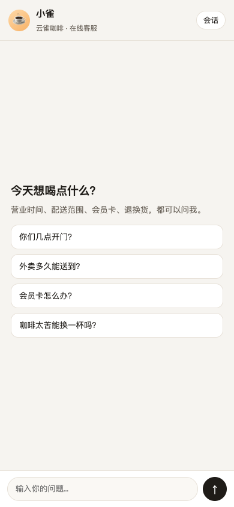
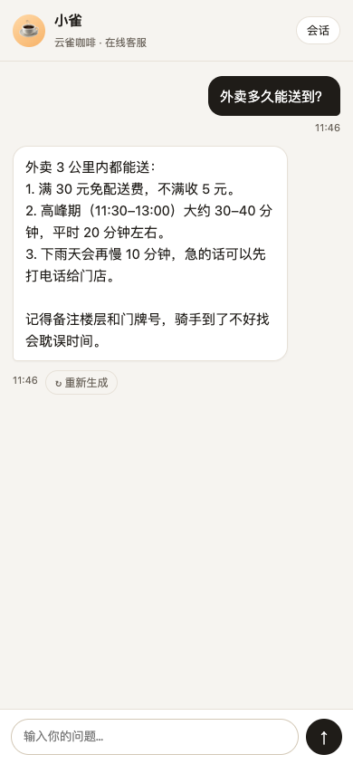

# Chatbot Starter

> 想要开箱即用、不用自己拼提示词的个人助理版本？看 [小助 · 懒人包](https://github.com/rchau8502/lazy-assistant)。

一个能改成任何场景的对话机器人模板：FastAPI + 任意 OpenAI 兼容大模型 + SSE 流式输出 + 上下文自动压缩 + SQLite 会话存储。前端是一个手机尺寸的聊天页，不用前端框架。

| 欢迎页 | 对话（SSE 流式） |
| --- | --- |
|  |  |

你只需要写两份 Markdown（人设、业务手册）和一份 `.env`（品牌文案、模型 key），代码不用动：

- 点单/售后/门店客服
- 员工流程助手（报销、请假、入职）
- 产品答疑、售前咨询
- 课程助教、知识库问答
- 个人英文陪练、写作教练

## 它自带什么

| 能力 | 说明 |
| --- | --- |
| 流式回复 | SSE 逐字推送，前端边收边显示，带闪烁光标 |
| 停止 / 重新生成 | 生成中发送键变停止键，半截回复标「已停止」留在会话里；最后一条可一键重答 |
| 多轮上下文 | 历史完整送进模型，超出阈值自动压成「备忘」，前端可展开查看 |
| 会话存储 | SQLite 存会话、消息、备忘；刷新回到上次会话；会话可新建、切换、删除 |
| 品牌可换 | 名字、头像 emoji、欢迎语、示例问题、主题色全部走 `.env` |
| 零前端依赖 | `static/index.html` 一个文件，原生 CSS + JS，没有构建步骤 |

## 三步改成你的机器人

```bash
git clone <this-repo> my-bot && cd my-bot
uv venv .venv && uv pip install -r requirements.txt   # 没装 uv：python3 -m venv .venv && .venv/bin/pip install -r requirements.txt
cp .env.example .env
```

1. **写人设**：编辑 `prompts/system.md`——它是谁、怎么回答、不知道时怎么办、边界在哪。
2. **写知识**：编辑 `prompts/handbook.md`——业务手册 / FAQ / 价格表 / 产品参数，会整段拼在 system prompt 后面。
3. **填配置**：`.env` 里填 `LLM_API_KEY`，按需改 `BOT_NAME`、`BOT_EMOJI`、`WELCOME_TITLE`、`EXAMPLE_QUESTIONS`、`BOT_ACCENT`。

```bash
.venv/bin/uvicorn app:app --host 127.0.0.1 --port 8010
# 打开 http://127.0.0.1:8010
```

没有 key 也能先看界面：`/api/chat` 会返回一条「服务端没有配置 LLM_API_KEY」的提示，其余功能正常。

## 接别的大模型

模板走的是 OpenAI 的 `/chat/completions` 协议，换个 base_url 就行：

```ini
# OpenAI
LLM_BASE_URL=https://api.openai.com/v1
LLM_MODEL=gpt-4o-mini

# 本地 Ollama
LLM_BASE_URL=http://127.0.0.1:11434/v1
LLM_MODEL=qwen2.5

# 通义 / Moonshot / 智谱等，填各自的兼容地址和模型名
```

## 目录

```
app.py                后端：接口、SSE、SQLite、上下文压缩、页面渲染
prompts/system.md     人设与规则（你主要改这个）
prompts/handbook.md   业务手册（你主要改这个）
static/index.html     手机聊天页，品牌文案由 {{占位符}} 注入
examples/hr/          示例：员工流程助手（报销/请假/入职）
tests/mock_upstream.py  假模型上游，无 key 时自测用
tests/smoke_test.py     端到端测试
docs/preview.png      界面截图
Dockerfile            部署用
.env.example          所有可配项
```

## 接口

| 方法 | 路径 | 作用 |
| --- | --- | --- |
| GET | `/` | 聊天页 |
| GET | `/api/health` | 健康检查，返回模型、key 是否配置、prompt 文件 |
| GET | `/api/sessions` | 会话列表 |
| POST | `/api/sessions` | 新建会话 |
| DELETE | `/api/sessions/{id}` | 删除会话 |
| GET | `/api/sessions/{id}/messages` | 会话详情 + 消息 |
| POST | `/api/chat` | 发消息，返回 SSE（`start` / `memo` / `delta` / `done` / `error`） |
| POST | `/api/sessions/{id}/regenerate` | 重答最后一条，同样是 SSE |

## 自测（不需要真 key）

```bash
# 1. 假上游（返回固定流式文本）
.venv/bin/uvicorn --app-dir tests mock_upstream:app --port 8011

# 2. 指向假上游的实例，压缩阈值调小好触发
LLM_BASE_URL=http://127.0.0.1:8011 LLM_API_KEY=mock-key CONTEXT_TOKEN_LIMIT=200 \
  .venv/bin/uvicorn app:app --port 8012

# 3. 跑测试
BASE_URL=http://127.0.0.1:8012 .venv/bin/python tests/smoke_test.py
```

覆盖：流式 + 落库、断连后保存半截并标「已停止」、超阈值压缩成备忘、重新生成替换而非追加、删除会话。

## 上下文压缩怎么工作

1. 每次请求前估算 `system + 备忘 + 历史` 的 token 数（汉字约 1 token，其余 4 字符 1 token）。
2. 超过 `CONTEXT_TOKEN_LIMIT` 时，把最近 `KEEP_RECENT_MESSAGES` 条之外的旧对话交给模型压成备忘（保留姓名、金额、日期、结论）。
3. 备忘写进 `sessions.memo`，旧原文从库里删除；下次请求把备忘接在 system prompt 后面。
4. 压缩失败不影响本次回答，日志里有告警。

## 部署

```bash
docker build -t my-bot .
docker run -p 8000:8000 --env-file .env -v "$PWD/data:/app/data" my-bot
```

或者直接用 systemd / supervisor 跑 `uvicorn app:app --host 0.0.0.0 --port 8000`，前面挂 Nginx。注意把 `data/` 持久化，那里存 SQLite。

## 关于安全与定位

- 这是单机、单团队的轻量模板：**没有登录和权限**，会话 id 不可猜（32 位 hex）但不等于鉴权。要公开给陌生人用，请自己在前面加鉴权/限流，或把会话 id 换成登录用户绑定。
- 模型 key 只在服务端 `.env`，不会下发到前端。
- `.gitignore` 已排除 `.env`、`data/`、`.venv/`，别把 key 和用户对话提交上去。

## License

MIT
